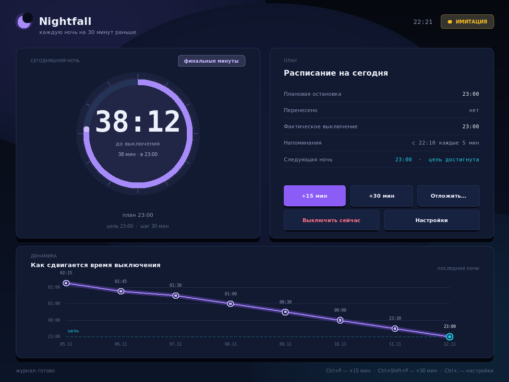
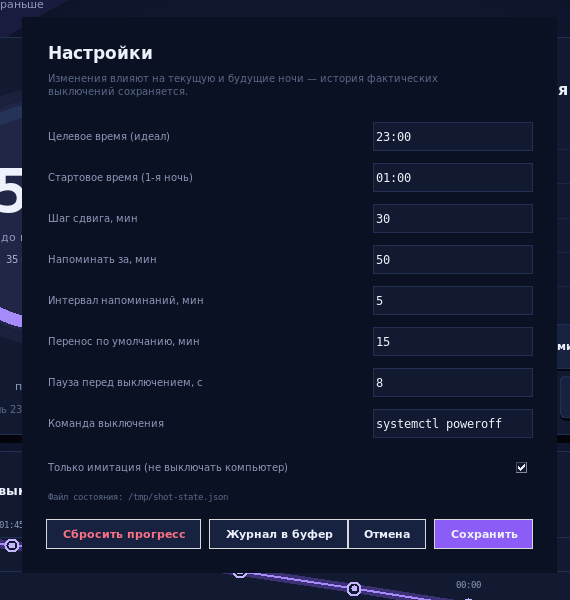

# Nightfall

**Плавный сдвиг времени выключения компьютера — чтобы лечь спать.**

Каждую ночь Nightfall выключает компьютер на 30 минут раньше, чем в предыдущую,
пока расписание не упрётся в идеальное время (по умолчанию **23:00**). За 50 минут
до выключения начинают приходить напоминания: каждые 5 минут, с обратным отсчётом.
Не успеваешь — выключение откладывается одной кнопкой, и это честно учитывается
в расписании следующей ночи.

Только стандартная библиотека Python. Linux.

Устроено как положено: **фоновая служба** владеет расписанием и работает без
всяких окон, а **окно — необязательный клиент**. Закрыли окно — оно свернулось
в иконку рядом с часами, и напоминания, переносы и выключение продолжают
работать: клик по иконке прячет открытое окно и открывает спрятанное, правый
клик — меню с состоянием и пунктом «выйти».

**Впервые здесь? → [Быстрый старт: пять минут до работающего расписания](docs/QUICKSTART.md)**



---

## Что именно делает программа

| Правило | Как работает |
|---|---|
| Шаг назад | Новая ночь планируется на **30 минут раньше фактического** выключения предыдущей |
| Потолок | Расписание никогда не уходит раньше целевого времени (23:00) — дальше просто держится на нём |
| Переносы | Каждый перенос сдвигает выключение и **запоминается как факт**: следующая ночь считается от реального момента выключения |
| Напоминания | За 50 минут до выключения, затем каждые 5 минут (−50, −45, … −5) |
| Пропущенная ночь | Если компьютер был выключен, шаг всё равно применяется **один раз** — расписание не «прыгает» вперёд |
| Факт важнее плана | В файл состояния пишется фактическое время выключения (с точностью до минуты) **до** вызова `poweroff` |

Пример прогресса (старт 01:00, цель 23:00):

```
ночь 1   01:00
ночь 2   00:30
ночь 3   00:00
ночь 4   23:30
ночь 5   23:00  ← цель достигнута, дальше держимся
```

Одна ночь с переносом `+15` мин выключается в `00:45`, и следующая ночь
считается от `00:45`, а не от плана `00:30`.

---

## Как это устроено

```
        ┌────────────────────┐
        │  nightfall --service│   фоновая служба (systemd или вручную)
        │  расписание, сокет  │───┐  владеет состоянием, тикает каждые 15 с,
        └────────────────────┘   │  выключает компьютер
                                 │  Unix-сокет  $XDG_RUNTIME_DIR/nightfall-UID.sock
        ┌────────────────────┐   │
        │  окно (клиент)      │───┤  можно открывать и закрывать сколько угодно
        ├────────────────────┤   │
        │  nightfall --status │───┤  командная строка — тоже клиент
        │  ... --postpone 15  │   │
        ├────────────────────┤   │
        │  всплывающее окно   │───┘  отдельный процесс на одно напоминание:
        │  «Осталось 35 мин»  │      показал, дал нажать «+15 мин» и вышел
        └────────────────────┘
```

* **Служба** (`--service`) — единственный, кто владеет расписанием. Её можно
  запустить из systemd и больше никогда не вспоминать.
* **Окно** ничего не решает само: раз в секунду спрашивает состояние и посылает
  команды. Закрыли — служба этого даже не заметит.
* **Напоминание** показывает короткоживущий процесс: окно с кнопкой переноса
  живёт 30 секунд и завершается. Постоянного окна в системе нет.
* Если служба не запущена, окно честно скажет «нет связи» и предложит её поднять.

---

## Установка

Нужен Python 3.9+ и tkinter (в большинстве дистрибутивов — пакет `python3-tk`).

```bash
# Debian/Ubuntu
sudo apt install python3 python3-tk libnotify-bin

# Fedora
sudo dnf install python3 python3-tkinter libnotify

# Arch
sudo pacman -S python tk libnotify
```

Клонируем и запускаем — никаких зависимостей ставить не нужно:

```bash
git clone https://github.com/DickJohnson123/nightfall.git
cd nightfall
python3 nightfall.py
```

Есть необязательный установщик (раскладывает файлы в `~/.local/share/nightfall`,
делает команду `nightfall` и, по желанию, автозапуск):

```bash
./install.sh                     # просто установить
./install.sh --autostart         # + запускать окно при входе в систему
./install.sh --service           # + systemd-сервис (работа без окна, в фоне)
```

---

## Запуск

```bash
python3 nightfall.py                # окно (служба поднимется сама, если её нет)
python3 nightfall.py --service      # только фоновая служба, без окна (для systemd)
python3 nightfall.py --status       # что запланировано (плюс история ночей)
python3 nightfall.py --postpone 15  # отложить на 15 минут
python3 nightfall.py --postpone     # отложить на значение по умолчанию
python3 nightfall.py --undo-postpone
python3 nightfall.py --shutdown-now # выключить прямо сейчас
python3 nightfall.py --real         # реальное выключение вместо имитации
python3 nightfall.py --dry-run      # вернуться в режим имитации
python3 nightfall.py --stop         # остановить службу
python3 nightfall.py --toggle       # переключить окно (то же, что клик по иконке)
python3 nightfall.py --show         # открыть окно (или разбудить свёрнутое)
python3 nightfall.py --hide         # свернуть окно в трей, ничего не останавливая
python3 nightfall.py --quit         # остановить окно, иконку в трее и службу
python3 nightfall.py --tray         # только иконка в трее, без окна
python3 nightfall.py --reset        # сбросить прогресс (старый файл -> .bak)
python3 nightfall.py --shift 45     # служебное: сдвинуть план на 45 мин раньше

python3 nightfall.py --state ./s.json --socket /tmp/nf.sock   # свои пути
```

Все команды, кроме `--service`, работают с уже запущенной службой по сокету и
завершаются сразу. Если службы нет, `--postpone`, `--reset` и `--real` всё равно
сработают — они применятся прямо к файлу состояния.

### Режим имитации — по умолчанию

Свежая установка **ничего не выключает**: в шапке горит жёлтый значок `ИМИТАЦИЯ`.
Программа честно ведёт расписание, показывает напоминания и записывает «фактическое»
время, но команду выключения не вызывает.

Включить реальное выключение:

* в окне: **Настройки → снять галочку «Только имитация»**;
* из консоли: `python3 nightfall.py --real` (применяется к работающей службе).

По умолчанию выполняется `systemctl poweroff` с паузой 8 секунд. Команду можно
изменить в настройках — например `loginctl poweroff` или `shutdown -h now`.

---

## Окно, трей и «куда всё делось»


Окно ведёт себя как обычное окно приложения:

| Действие | Что происходит |
|---|---|
| Запуск `nightfall` | открывается окно, служба и иконка поднимаются сами |
| Крестик / `Ctrl+Q` ... пока иконка жива | окно **прячется** в трей, всё остальное работает |
| Клик по иконке | **переключает** окно: открытое прячет, спрятанное открывает (или запускает, если окна нет) |
| Правый клик по иконке | меню: строка состояния и «Остановить службу и выйти» |
| Кнопки в заголовке окна | только крестик: «свернуть» и «развернуть» не нужны — окно постоянного размера, а прячет его иконка |
| Повторный запуск `nightfall` | не открывает второе окно, а поднимает уже существующее |

Если трея в системе нет вовсе, крестик закрывает окно по-настоящему, а служба
продолжает работать — расписание от окна не зависит.

**Про зависимость.** Иконку в панели рисует не Python, а сама система, поэтому
для неё нужен один из трёх механизмов (выбирается автоматически):

| Бэкенд | Что нужно | Где работает |
|---|---|---|
| `statusicon` | PyGObject + `gir1.2-gtk-3.0` и классический XEmbed-трей | Xfce, Cinnamon, MATE, KDE, i3 + stalonetray |
| `appindicator` | PyGObject + `gir1.2-ayatanaappindicator3-0.1` и хост StatusNotifierItem в панели | GNOME (с расширением), KDE |
| `yad` | утилита `yad` | почти везде, где есть X11 |

```bash
sudo apt install python3-gi gir1.2-gtk-3.0                # GTK-иконка
sudo apt install gir1.2-ayatanaappindicator3-0.1          # современный AppIndicator
sudo apt install yad                                      # запасной вариант

python3 nightfall.py --tray-backend detect                # какой бэкенд найдётся
NIGHTFALL_TRAY_BACKEND=statusicon python3 nightfall.py     # выбрать вручную
```

Если ни одного механизма нет, `detect` напечатает `none`: программа работает
как обычно, просто без иконки — сама Nightfall при этом остаётся на чистой
стандартной библиотеке.

Порядок важен: сначала пробуется `statusicon` — это единственный механизм,
который отдаёт приложению сам клик по иконке, поэтому левая кнопка честно
переключает окно. `appindicator` идёт вторым: libappindicator показывает меню
на любой клик и не сообщает приложению о нажатии — так устроена библиотека,
а не Nightfall. Есть третий путь — `nightfall --toggle` в терминале.

---

## Как отложить выключение

* кнопка **«+15 мин»** в окне (значение по умолчанию настраивается);
* кнопка **«+30 мин»**;
* **«Отложить…»** → любое значение: 5, 10, 15, 30, 45, 60 минут и «Отменить последний перенос»;
* в самом всплывающем напоминании — кнопка переноса;


* горячие клавиши: `Ctrl+P` — +15 минут, `Ctrl+Shift+P` — +30 минут, `Ctrl+,` — настройки, `Ctrl+Q` — выход;
* из терминала: `nightfall --postpone 15`, `nightfall --undo-postpone` — работает и без окна.

Каждый перенос записывается в историю ночи (`postponements`) и влияет на завтрашний план.

---

## Настройки



| Параметр | По умолчанию | Смысл |
|---|---|---|
| Целевое время (идеал) | 23:00 | раньше него расписание не уходит |
| Стартовое время (1-я ночь) | 01:00 | с чего начинаем, если истории ещё нет |
| Шаг сдвига, мин | 30 | на сколько раньше каждая следующая ночь |
| Напоминать за, мин | 50 | начало серии напоминаний |
| Интервал напоминаний, мин | 5 | период серии |
| Перенос по умолчанию, мин | 15 | значение кнопки «+15 мин» |
| Пауза перед выключением, с | 8 | задержка между уведомлением и `poweroff` |
| Команда выключения | `systemctl poweroff` | что именно выполнять |
| Только имитация | включено | не выключать компьютер по-настоящему |

Изменение правил сдвига (цель, шаг, стартовое время) пересобирает **текущую и будущие**
ночи; история фактических выключений не трогается.

---

## Где хранится состояние

`~/.config/nightfall/state.json` (или `$XDG_CONFIG_HOME/nightfall/state.json`),
права `600`. Запись атомарная: временный файл + `os.replace`, поэтому внезапное
выключение питания не портит историю.

```json
{
  "version": 1,
  "settings": { "goal_time": "23:00", "step_minutes": 30, "initial_time": "01:00",
                "warn_lead_minutes": 50, "warn_interval_minutes": 5,
                "postpone_minutes": 15, "shutdown_command": ["systemctl", "poweroff"],
                "dry_run": true, "grace_minutes": 90, "shutdown_delay_seconds": 8 },
  "nights": [
    {
      "evening": "2026-11-10",
      "target": "2026-11-11T00:30",
      "postponements": [{ "at": "2026-11-11T00:12", "minutes": 15 }],
      "actual": "2026-11-11T00:45",
      "skipped": false,
      "fired": [50, 45, 40, 35, 30, 25, 20, 15, 10, 5]
    }
  ]
}
```

* `target` — план без переносов, `actual` — фактическое время выключения;
* `skipped` — ночь прошла без программы (компьютер был выключен);
* `fired` — уже показанные напоминания, чтобы не спамить после выхода из сна;
* история хранится за последние 180 ночей.

Вернуть состояние из резервной копии: скопировать `state-*.json.bak` поверх `state.json`.

---

## Автозапуск

Рекомендуемый вариант — служба в systemd user, окно открывать только по желанию:

```bash
mkdir -p ~/.config/systemd/user
cp packaging/nightfall.service ~/.config/systemd/user/
# при необходимости поправить путь в ExecStart и добавить --real
systemctl --user daemon-reload
systemctl --user enable --now nightfall.service
journalctl --user -u nightfall.service -f
```

Если хочется, чтобы при входе открывалось ещё и окно:

```bash
./install.sh --autostart      # ~/.config/autostart/nightfall.desktop
```

Установщик `./install.sh [--autostart] [--service]` раскладывает файлы в
`~/.local/share/nightfall`, делает команду `nightfall` и, при желании, ставит
автозапуск окна и/или службу.

---

## Нагрузка

Замеры на Linux (Python 3.13), нагрузка на одно ядро:

| Процесс | CPU | Память (RSS) |
|---|---|---|
| служба `--service`, клиентов нет | ~0.00 % | 16 МБ |
| служба, пока открыто окно | ~0.15 % | 16 МБ |
| окно-клиент (обновление раз в минуту вне финального часа) | ~0.07 % | 29 МБ |
| иконка в трее (GTK/AppIndicator или `yad`) | ~0.0–0.1 % | 12–30 МБ, зависит от бэкенда |
| всплывающее напоминание | живёт 30 с, потом исчезает | 25 МБ на эти 30 с |

Почему так скромно:

* служба просыпается раз в 15 секунд и сразу засыпает — в простое её не слышно;
* окно перерисовывается только при изменении видимого содержимого: пока осталось
  больше часа — раз в минуту, в последний час — раз в секунду, свёрнутое — никогда;
* фон интерфейса (градиент и свечение, ~180 элементов Canvas) рисуется один раз;
* состояние пишется только на событиях (напоминание, перенос, выключение),
  атомарно, несколько килобайт;
* сети программа не использует вообще: только локальный Unix-сокет.

---

## Тесты

```bash
python3 -m unittest discover -s tests -t . -v
```

59 тестов: шаг назад, упирание в цель, переносы, серия напоминаний, отсутствие
спама после долгого сна, пропущенные ночи, сериализация, неделя ускоренной
симуляции с записью в файл, а также служба и её сокет — команды, переносы,
настройки, остановка и работа без демона, — и связка окно/трей/служба: передача
путей дочерним процессам, выбор бэкенда трея, поиск интерпретатора с PyGObject,
«показать окно» вместо запуска второго.

---

## Структура проекта

```
nightfall.py            точка входа
nightfall/schedule.py   чистая логика: ночи, шаг, переносы, напоминания
nightfall/controller.py расписание + хранилище + уведомления (движок службы)
nightfall/daemon.py     фоновая служба: тик, сокет, всплывающие окна
nightfall/ipc.py        Unix-сокет, JSON-протокол
nightfall/client.py     клиент службы (окно, CLI, напоминания)
nightfall/session.py    окно/трей/служба как равноправные клиенты: сокеты, запуск
nightfall/tray.py       иконка в трее: appindicator, statusicon, yad
nightfall/storage.py    атомарное JSON-хранилище
nightfall/notify.py     notify-send и запуск команды выключения
nightfall/ui.py         интерфейс на Canvas (без внешних зависимостей)
nightfall/cli.py        разбор аргументов, команды
tests/                  unittest
packaging/              systemd unit и autostart-файл
```

Интерфейс целиком нарисован на `Canvas`: скруглённые карточки, кольцо-таймер,
график сдвига и собственные кнопки — поэтому он не зависит от системной темы
и одинаково аккуратно выглядит в GNOME, KDE и в лёгких WM.

---

## Ограничения

* Расписание живёт, пока запущена **служба** (`--service`). Окно для работы
  не нужно: его можно закрывать и открывать заново.
* Один файл состояния — одна служба: второй демон на том же файле не запустится
  (блокировка), а вот окно открыть можно сколько угодно.
* Linux с systemd/logind. На других системах нужно поменять команду выключения.
* Уведомления на рабочем столе показываются через `notify-send`; если его нет,
  остаются всплывающие окна самого Nightfall.
* Часовой пояс не учитывается отдельно — используется локальное время системы.
* Иконка в панели — единственная часть, которая не может быть на стандартной
  библиотеке: её рисует система. Нужен PyGObject (GTK/AppIndicator) или `yad`;
  нет ни того, ни другого — программа работает без иконки, а крестик просто
  закрывает окно, не мешая службе.
* Если в системе есть только AppIndicator (нет классического XEmbed-трея),
  клик по иконке открывает меню, а не переключает окно: libappindicator не
  сообщает приложению о нажатии. Обойти можно через `nightfall --toggle`.

## Лицензия

MIT — см. [LICENSE](LICENSE).
