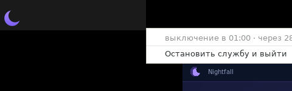

# Быстрый старт Nightfall

Пошагово: от «скачал» до «компьютер сам выключается в 23:00». Займёт минут пять.

---

## 1. Установить

```bash
git clone https://github.com/DickJohnson123/nightfall.git
cd nightfall
```

Нужен Python 3.9+ и tkinter — им Nightfall и окно, и напоминания рисует.
`libnotify` нужен только на случай, когда карточку показать нечем:

```bash
# Debian/Ubuntu
sudo apt install python3 python3-tk libnotify-bin
# Fedora
sudo dnf install python3 python3-tkinter libnotify
# Arch
sudo pacman -S python tk libnotify
```

Никаких `pip install` не требуется — только стандартная библиотека.

## 2. Первый запуск

```bash
python3 nightfall.py            # служба + иконка в трее, без окна
python3 nightfall.py --window   # если хочется сразу увидеть окно
```

Программа поднимет **фоновую службу** (она владеет расписанием) и покажет иконку
рядом с часами. Окно само не открывается — при автозагрузке на весь экран ничего
не всплывает: клик по иконке открывает окно, повторный клик прячет.

По умолчанию программа считает, что сейчас вы ложитесь в **01:00**, цель —
**23:00**, шаг — **30 минут**, поэтому ближайшее выключение планируется на 01:00.
В шапке окна видно `ФОН · 1234` — это pid службы.

Если трей в системе не поднялся (нет ни PyGObject, ни `yad`), окно откроется
само: иначе не было бы ни одного видимого признака, что программа работает.

## 3. Настроить под себя

`Ctrl+,` или кнопка **«Настройки»**:

1. **Стартовое время (1-я ночь)** — во сколько вы реально выключаете компьютер
   *сегодня*. Это точка отсчёта, дальше программа идёт сама.
2. **Целевое время (идеал)** — оставьте `23:00` (или поставьте своё).
3. **Шаг сдвига** — `30` минут.
4. Галочку **«Только имитация»** на первом вечере лучше оставить включённой: всё будет
   работать, но компьютер не выключится.
5. **Сохранить**.

## 4. Убедиться, что напоминания приходят

Ждать ночи не нужно:

```bash
python3 nightfall.py --shift 45
```

Это сдвинет план текущей ночи на 45 минут раньше — в течение пары минут придут
напоминания и сработает (в режиме имитации) «выключение». После проверки:

* **Настройки → «Сбросить прогресс»** — вернёт расписание к стартовому времени
  (старый файл состояния останется рядом как `.bak`).

## 5. Включить настоящее выключение

Снять галочку **«Только имитация»** в настройках (в шапке `ИМИТАЦИЯ` сменится на
`БОЕВОЙ РЕЖИМ`) или запускать так:

```bash
python3 nightfall.py --real
```

По умолчанию выполняется `systemctl poweroff` с паузой 8 секунд после уведомления.
Если в вашей системе для этого нужен пароль/подтверждение — выключение не произойдёт,
а Nightfall покажет красное окно «Не удалось выключить» и запишет причину в журнал;
тогда поменяйте команду в настройках, например на `loginctl poweroff`.

## 6. Сделать так, чтобы служба запускалась сама

Окно держать открытым **не нужно** — достаточно, чтобы работала служба.
Автозапуск окна не открывает: при входе в систему появляется только иконка
в трее.

```bash
./install.sh --service                    # ставит systemd-юнит
systemctl --user enable --now nightfall.service
journalctl --user -u nightfall.service -f # посмотреть, что происходит

./install.sh --autostart                  # опционально: иконка в трее при входе (без окна)
```

Для реального выключения добавьте `--real` в `ExecStart` юнита.

Проверить и управлять можно в любой момент, окно не требуется:

```bash
nightfall --status          # план, остаток, история
nightfall --postpone 15     # отложить
nightfall --shutdown-now    # выключить сразу
nightfall --stop            # остановить службу
nightfall --toggle          # показать/спрятать окно
```

---

## Как этим пользоваться каждый день

Ничего делать не надо: служба работает в фоне и сама двигает расписание.
Открывайте окно только когда хочется посмотреть план или отложить выключение —
закрыть его потом можно спокойно.

| Вечер | Что происходит |
|---|---|
| за 50 минут | первая карточка внизу экрана, дальше каждые 5 минут (вверху экрана ничего не дублируется) |
| не успеваете | **«+15 мин»**, **«+30 мин»**, **«Отложить…»** или кнопка переноса в самом уведомлении |
| в момент X | компьютер выключается; в файл состояния пишется фактическое время |
| на следующий день | план автоматически на 30 минут раньше фактического вчерашнего |

Перенос **не бесплатен**: отложили на 30 минут — завтрашний шаг вперёд «съеден»,
расписание останется на месте. Это видно на графике внизу окна.

Когда план дойдёт до целевого времени (23:00), он там и останется — раньше программа
не уводит.

---

## Окно, иконка и полный выход



Окно можно просто закрыть: если в системе есть трей, оно свернётся в иконку
рядом с часами, а служба продолжит считать время и напоминать. Полоску заголовка
рисует сам Nightfall, поэтому в ней только крестик — «свернуть» и «развернуть»
отсутствуют, а перетаскивается окно за эту же полоску.

| Что сделать | Что будет |
|---|---|
| крестик или `Ctrl+Q` | окно прячется в трей (служба работает) |
| клик по иконке | окно **переключается**: открытое прячется, спрятанное открывается |
| правый клик по иконке | меню: состояние и **«Остановить службу и выйти»** |
| `nightfall --toggle` | то же переключение из терминала |
| `nightfall --show` / `--hide` | открыть / спрятать окно из терминала |
| `nightfall --quit` | остановить всё: окно, иконку и службу |

Иконку рисует система, а не Python, поэтому нужен один из механизмов:
GTK/PyGObject (`sudo apt install python3-gi gir1.2-gtk-3.0`) или утилита `yad`
(`sudo apt install yad`). Что нашлось — покажет одна команда:

```bash
python3 nightfall.py --tray-backend detect     # appindicator / statusicon / yad / none
```

Если в системе нет ни трея, ни `yad`, всё равно работает: крестик закрывает окно,
а служба живёт своей жизнью. Подробности — в [README](../README.md#окно-трей-и-куда-всё-делось).

---

## Что показывает окно

* **Кольцо-таймер** — сколько осталось до выключения. Заполненность кольца = остаток
  окна напоминаний (50 минут), цвет: фиолетовый → янтарный (последние 30 мин) →
  красный (последние 10 мин).
* **«Расписание на сегодня»** — план, сумма переносов, фактическое время, начало серии
  напоминаний и план на следующую ночь.
* **«Динамика»** — последние ночи точками: ниже линия — раньше выключение, пунктир — цель.
* **Шапка** — текущее время и режим (`ИМИТАЦИЯ` / `БОЕВОЙ РЕЖИМ`).
* **Низ окна** — журнал: последнее событие.

## Горячие клавиши

| Клавиши | Действие |
|---|---|
| `Ctrl+P` | перенести на 15 минут |
| `Ctrl+Shift+P` | перенести на 30 минут |
| `Ctrl+,` | настройки |
| `Ctrl+H` | спрятать окно в трей (то же, что крестик) |
| `Ctrl+Q` | спрятать окно (полный выход — через меню иконки или `--quit`) |

---

## Если что-то не так

| Симптом | Что делать |
|---|---|
| Уведомления не появляются | установить `libnotify-bin`; проверить режим «Не беспокоить»; окно Nightfall показывает напоминания в любом случае |
| Компьютер не выключился | посмотреть журнал внизу окна; скорее всего `systemctl poweroff` требует прав — сменить команду в настройках |
| Расписание «замерло» | остановлена служба, а не окно: `nightfall --status` покажет «фон не запущен» → `nightfall --service` или systemd |
| В шапке «ФОН ОСТАНОВЛЕН» | служба не отвечает: нажмите «Запустить фон» в окне или `systemctl --user start nightfall` |
| Ночь отмечена «пропущена» | компьютер был выключен в момент плана; шаг всё равно применился один раз |
| Окно больше экрана, низ не видно | окно подстраивается само; если всё равно велико — запустить с `NIGHTFALL_SCALE=0.85 nightfall` |
| После включения компьютера иконки нет | служба поднимает её сама, как только появляется дисплей (до 20 с); проверить журнал: `nightfall --doctor` и `nightfall --logs 30` |
| Нет иконки рядом с часами | поставить механизм иконки: `sudo apt install python3-gi gir1.2-gtk-3.0` или `sudo apt install yad`, затем `nightfall --tray-backend detect`; без иконки всё работает, просто окно закрывается совсем |
| Иконка есть, но клик ничего не делает | `nightfall --logs 20`: если есть строка «клик по иконке», окно не смогло стартовать — обычно не хватает `sudo apt install python3-tk`; Nightfall подберёт Python с tkinter сам, а при неудаче покажет карточку «Окно не открылось» |
| Иконка есть, но клик открывает меню | это AppIndicator: окно открывает первый пункт меню (ограничение libappindicator) |
| Хочу начать заново | Настройки → «Сбросить прогресс» (история сохранится в `state-*.json.bak`) |
| Где данные | `~/.config/nightfall/state.json` |
| Что запланировано | `python3 nightfall.py --plan` |

Больше деталей — в [README](../README.md).
